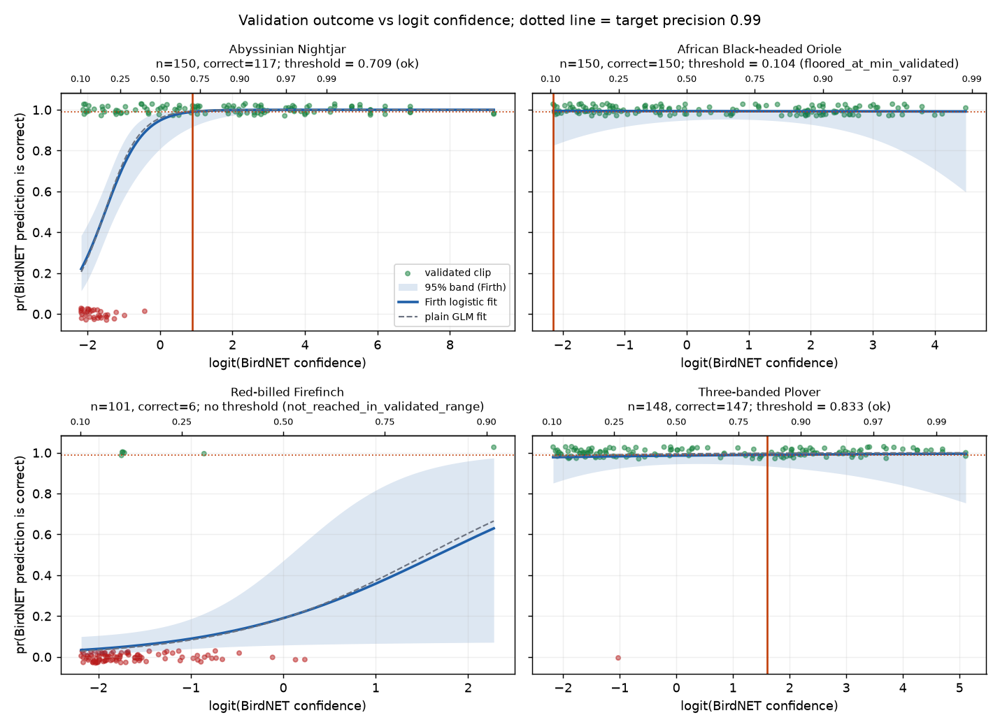
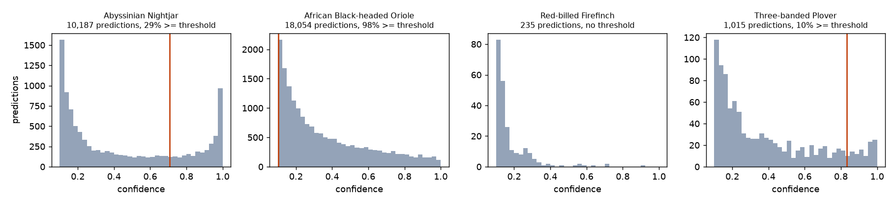
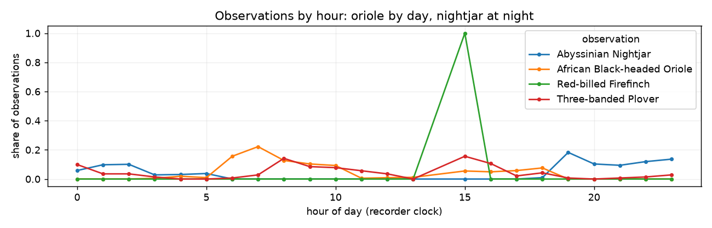

# Birds Challenge
## Question 1: Find an observation label for every BirdNET prediction

**Question.** Using a 99% probability of correctness cutoff, assign each clip in `birdnet_predictions` a label in a new `observation` field.

**Answer.** Every one of the 29,491 predictions now has an `observation` field. It holds the species name when we are at least 99% sure that the prediction is correct, and is empty otherwise. **20,751 predictions are observations.**

File: [`outputs/birds/birdnet_predictions_with_observations.csv`](../outputs/birds/birdnet_predictions_with_observations.csv)

How to build it for the platform is in the second report: [`02_bird_tech_handoff.md`](02_bird_tech_handoff.md). The analysis with all tables and figures is in [`notebooks/01_birds_thresholds.ipynb`](../notebooks/01_birds_thresholds.ipynb).


## 1. Result

<table>
<tr><th>Species</th><th>Threshold</th><th>Predictions</th><th>Observations</th><th>Comment</th></tr>
<tr><td>Nightjar</td><td>0.709</td><td>10,187</td><td>2,963</td><td>Clear curve. Errors at low scores.</td></tr>
<tr><td>Oriole</td><td>0.104</td><td>18,054</td><td>17,646</td><td>All 150 checks correct. Threshold at the lowest checked score. Needs more checks.</td></tr>
<tr><td>Firefinch</td><td>none</td><td>235</td><td>1</td><td>Only 6 of 101 checks correct. The 99% level is never reached. The one observation is a clip confirmed by an ornithologist.</td></tr>
<tr><td>Plover</td><td>0.833</td><td>1,015</td><td>141</td><td>Only one error in 148 checks. Threshold is uncertain.</td></tr>
<tr><td><b>Total</b></td><td></td><td><b>29,491</b></td><td><b>20,751</b></td><td></td></tr>
</table>

Short names: Nightjar (*Caprimulgus poliocephalus*), Oriole (*Oriolus larvatus*), Firefinch (*Lagonosticta senegala*), Plover (*Charadrius tricollaris*).

When BirdNET predicts Nightjar with a score of 0.709 or more, we can be 99% sure that the prediction is correct. For Plover the score is 0.833.


## 2. Data

1. **Predictions:** 29,491 rows from 1,696 recordings, 43 recorders, 20 June to 12 July 2023. Each row is one 3 second segment with a species and a score. The lowest score in the file is 0.100, which is the minimum score set when BirdNET was run.
2. **Validations:** 551 clips checked by ornithologists. Each has the species, the score, and the answer: 1 correct, 0 incorrect.

The checked clips are not a random sample of the predictions. About 30% have a score below 0.2 and about 40% have a score of 0.8 or more. Few are in the middle. This is useful to fit a curve, but it means we cannot use the share of correct checks as the precision of all predictions.


## 3. Method

The approach in the publication Wood and Kahl 2024 was followed. The plot the logit of the score on the x axis and the probability that the prediction is correct on the y axis, fit a curve, and read the threshold from the curve.

### Link checked clips to predictions

A checked clip has a file name like `0.148_4_RBS55_20230628_060002.wav`: the score with 3 decimals, an export number, and the recording. There is no prediction id.

We link a clip to a prediction only when exactly **one** prediction of that species in that recording has the same score after rounding to 3 decimals. We never guess.

<table>
<tr><th>Result</th><th>Clips</th></tr>
<tr><td>Linked to one prediction</td><td>204</td></tr>
<tr><td>Recording not in the predictions file</td><td>288</td></tr>
<tr><td>More than one possible prediction</td><td>45</td></tr>
<tr><td>No prediction with that score</td><td>14</td></tr>
</table>

All clips are used to fit the curve, because the curve only needs the score and the answer. Only linked clips can give a human label to a prediction. Two clips were exported and checked twice; we count each once.

### Fit one curve for each species

```
log odds (prediction is correct) = b0 + b1 × logit(score)
```

with `logit(score) = log(score / (1 minus score))`. BirdNET scores are packed close to 1, and the logit spreads them out.

We fit this with **Firth logistic regression** instead of the usual logistic regression (GLM). The reason is in section 4.

```python
from birds.firth import firth_logit

fit = firth_logit(design, outcome)
b0, b1 = fit.coef
```

### Read the threshold from the curve

The threshold is the **lowest score from which the fitted probability of being correct stays at or above 0.99**. When the curve rises, this is the point where it crosses 0.99: the score `s` that solves `b0 + b1 × logit(s) = logit(0.99)`.

We only accept a threshold **inside the range of checked scores**. Above the highest checked score nobody has listened to a clip, so the curve has no data there.

### Label each prediction

The first rule that applies wins:

<table>
<tr><th>Rule</th><th><code>observation_status</code></th><th>Observation?</th></tr>
<tr><td>An ornithologist checked this clip and said correct</td><td><code>validated_correct</code></td><td>yes</td></tr>
<tr><td>An ornithologist checked this clip and said incorrect</td><td><code>validated_incorrect</code></td><td>no</td></tr>
<tr><td>Species has a threshold and the score is at or above it</td><td><code>above_threshold</code></td><td>yes</td></tr>
<tr><td>Species has a threshold and the score is below it</td><td><code>below_threshold</code></td><td>no</td></tr>
<tr><td>Species has no threshold</td><td><code>no_threshold_for_species</code></td><td>no</td></tr>
</table>

This is the core of the code in `src/birds/labeling.py`:

```python
out["observation_status"] = np.select(
    [
        out["validated_outcome"] == 1,
        out["validated_outcome"] == 0,
        above,
        has_thr,
    ],
    [STATUS_HUMAN_TRUE, STATUS_HUMAN_FALSE, STATUS_ABOVE, STATUS_BELOW],
    default=STATUS_NO_THRESHOLD,
)
is_obs = out["observation_status"].isin([STATUS_HUMAN_TRUE, STATUS_ABOVE])
out["observation"] = out["common_name"].where(is_obs)
```

### Measure how sure we are about each threshold

1. **Bootstrap:** resample the checked clips 1,000 times, refit, and keep the middle 95% of the thresholds.
2. **Careful threshold:** the score where the lower edge of the 95% band of the curve reaches 0.99.
3. **Direct check:** among checked clips above the threshold, the share that are correct, with a 95% lower bound.


## Decisions and trade offs

**1. Firth logistic regression instead of the usual GLM.**
For Oriole all checks are correct, and the usual GLM has no solution. For Plover there is only one error, and the GLM becomes very confident and gives a threshold of 0.260. Firth adds a small correction that always gives a solution. For Nightjar, where the data are good, both methods agree (0.709 and 0.667).

**2. No threshold outside the checked score range.**
For Firefinch the curve reaches 0.99 only at a score of 0.999, but the highest checked Firefinch clip has a score of 0.907.

**3. Flat curve: threshold at the lowest checked score.**
For Oriole the curve is above 0.99 at every checked score, so the threshold is the lowest checked score, 0.104. This is very close to the BirdNET minimum of 0.100, so nearly all Oriole predictions become observations.

**4. A human answer is stronger than the threshold.**
If an ornithologist checked a clip, their answer is used. This changes 68 of the 202 checked predictions: 32 Nightjar, 35 Plover and 1 Firefinch clips are below the threshold but were confirmed as correct, so they become observations. No checked clip above a threshold was marked incorrect. If two checks of the same clip disagree, we use neither.

**5. Only certain links.**
We link a check to a prediction only when there is exactly one match. A wrong link would put a human label on the wrong clip.

**6. The point estimate is the main result.**
We need to get the score where we are 99% sure according to the fitted curve which results in the following results:

<table>
<tr><th>Species</th><th>Chosen (Firth)</th><th>Plain GLM</th><th>Careful threshold</th><th>Bootstrap 95% range</th></tr>
<tr><td>Nightjar</td><td>0.709</td><td>0.667</td><td>0.953</td><td>0.50 to 0.87</td></tr>
<tr><td>Oriole</td><td>0.104</td><td>no solution</td><td>none</td><td>0.104 to 0.106</td></tr>
<tr><td>Firefinch</td><td>none</td><td>none</td><td>none</td><td>almost always none</td></tr>
<tr><td>Plover</td><td>0.833</td><td>0.260</td><td>none</td><td>0.10 to 0.96</td></tr>
</table>

**7. Logit scale and score limits.**
Scores are limited to the range 0.0001 to 0.9999 before the logit, so a score of exactly 1 does not give an infinite value.


## 5. Figures



*Each panel is one species. Points are checked clips (green correct, red incorrect). The blue line is the Firth curve with its 95% band. The grey dashed line is the usual GLM. The dotted line is the 0.99 target and the vertical line is the threshold.*



*Scores of all predictions for each species. The vertical line is the threshold.*



*Check without the ornithologists. Nightjar is active at dusk and at night, Oriole by day. 77% of Nightjar observations are at night (20:00 to 04:59), against 2% for Oriole. If many wrong predictions passed the thresholds, these patterns would be weaker.*


## 6. The output file

`birdnet_predictions_with_observations.csv` keeps every original column and adds:

<table>
<tr><th>Column</th><th>Meaning</th></tr>
<tr><td><code>observation</code></td><td>Species name if the prediction is an observation, empty otherwise. <b>This is the field asked for in the brief.</b></td></tr>
<tr><td><code>observation_status</code></td><td>Which rule decided (section 3, step 4).</td></tr>
<tr><td><code>decision_source</code></td><td><code>human_validation</code>, <code>probabilistic_threshold</code> or <code>none</code>.</td></tr>
<tr><td><code>threshold_used</code></td><td>Threshold of the species, empty if there is none.</td></tr>
<tr><td><code>threshold_status</code></td><td><code>ok</code>, <code>floored_at_min_validated</code> or <code>not_reached_in_validated_range</code>.</td></tr>
<tr><td><code>p_correct</code></td><td>Fitted probability that the prediction is correct.</td></tr>
<tr><td><code>validated_outcome</code></td><td>Ornithologist answer if the clip was checked and linked.</td></tr>
</table>

Example rows (Nightjar, threshold 0.709):

<table>
<tr><th>Recording</th><th>Score</th><th><code>p_correct</code></th><th>Checked</th><th><code>observation_status</code></th><th><code>observation</code></th></tr>
<tr><td>RBS14_20230627_190000</td><td>0.754</td><td>0.994</td><td></td><td>above_threshold</td><td>Abyssinian Nightjar</td></tr>
<tr><td>RBS02_20230622_190000</td><td>0.103</td><td>0.223</td><td></td><td>below_threshold</td><td></td></tr>
<tr><td>RBS14_20230627_230000</td><td>0.750</td><td>0.993</td><td>correct</td><td>validated_correct</td><td>Abyssinian Nightjar</td></tr>
<tr><td>RBS40_20230702_180000</td><td>0.139</td><td>0.357</td><td>incorrect</td><td>validated_incorrect</td><td></td></tr>
</table>

Count by status:

<table>
<tr><th>Species</th><th>validated correct</th><th>validated incorrect</th><th>above threshold</th><th>below threshold</th><th>no threshold</th></tr>
<tr><td>Nightjar</td><td>76</td><td>16</td><td>2,887</td><td>7,208</td><td>0</td></tr>
<tr><td>Oriole</td><td>26</td><td>0</td><td>17,620</td><td>408</td><td>0</td></tr>
<tr><td>Firefinch</td><td>1</td><td>27</td><td>0</td><td>0</td><td>207</td></tr>
<tr><td>Plover</td><td>56</td><td>0</td><td>85</td><td>874</td><td>0</td></tr>
<tr><td><b>Total</b></td><td><b>159</b></td><td><b>43</b></td><td><b>20,592</b></td><td><b>8,490</b></td><td><b>207</b></td></tr>
</table>
