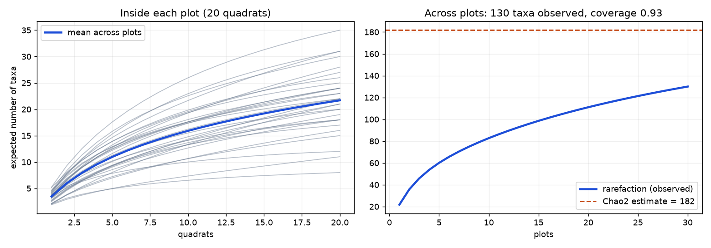
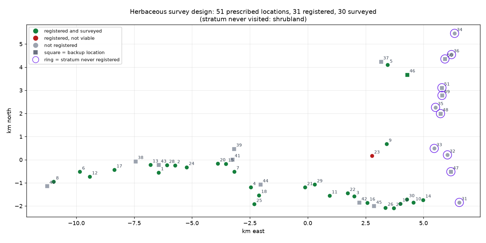
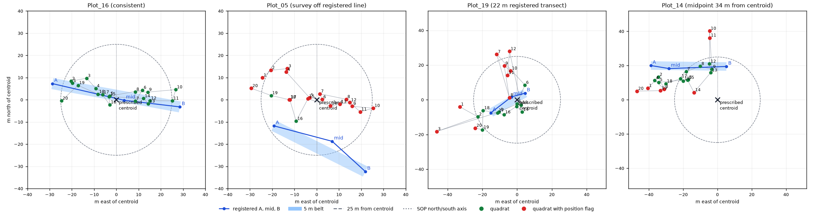
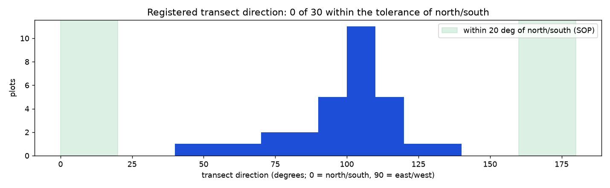

# Herbaceous vegetation: data quality report

**Project:** Savanna Monitoring Pilot, area Lewa (LW), baseline 2026 
**Surveys:** 19 May 2026 to 27 May 2026, 32 submissions by 2 recorders (Grace and Sam)

This document aims to give a data quality report with the following parameters:
a. a survey level summary
b. a plot level summary
c. an assessment of sampling effort
d. a map of transect locations.

**No data were changed.** Every problem is **flagged, not fixed**. The numbers and tables in this report are produced by the code (the module `vegetation.report`), so they match the data.

- The handoff for the Tech team is in [`04_vegetation_tech_handoff.md`](04_vegetation_tech_handoff.md).
- The analysis is in [`notebooks/02_vegetation_qaqc.ipynb`](../notebooks/02_vegetation_qaqc.ipynb).

## Main findings

1. **One stratum was never sampled.** The design has 51 prescribed locations. 31 were registered and 30 were surveyed. None of the 11 locations in the stratum **shrubland** was registered, so the results describe the savanna only.
2. **Transects do not follow the north/south rule.** The SOP asks for transects along the north/south axis. 30 of 30 registered transects are more than 20 degrees away from it; their bearings go from 50 to 131 degrees, so they run roughly east to west.
3. **Registered transect geometry is often not plausible.** 11 transects are not close to 50 m long (from 23 to 66 m), and in 14 the midpoint is not on the line from A to B. In 4 surveys the quadrats lie more than 10 m away from the registered line.
4. **Many taxa are not identified.** 60 of 130 taxa (46%) are unidentified morphospecies (`herb_xxx`). 58% of all records come from the additional species section (typed names and unknown placeholders), not from the species list. Typed names have spelling problems and duplicates. So the richness numbers are an upper limit.
5. **Twenty quadrats do not find all species in a plot.** The median sample coverage in a plot is 0.88. The last 5 quadrats still add 2.5 taxa on average.
6. **The form summary is wrong.** The number of "quadrats with species" saved by the form differs from the records in 23 submissions.
7. **Field completeness is very good.** Every quadrat has a photo and a GPS point, and every GPS point is accurate to 5 m or better.

## How the data were processed

### Steps

1. **Load.** Read the 4 ODK exports and the 11 entity lists as delivered.
2. **Clean.** Give short names to the columns and parse times (UTC), numbers and lists. No value is changed or removed.
3. **Join.** Link the tables:

<table>
<tr><th>From</th><th>To</th><th>Key</th></tr>
<tr><td>survey</td><td>quadrat</td><td><code>KEY</code> to <code>PARENT_KEY</code></td></tr>
<tr><td>quadrat</td><td>additional species</td><td><code>KEY</code> to <code>PARENT_KEY</code></td></tr>
<tr><td>survey</td><td>vegplot entity</td><td><code>selected_plot_uuid</code> to <code>__id</code></td></tr>
<tr><td>vegplot entity</td><td>centroid and registration</td><td><code>plot_uuid</code> to centroid <code>__id</code></td></tr>
<tr><td>quadrat</td><td>species list</td><td>each id in <code>selected_herb_species_uuids</code></td></tr>
<tr><td>additional species</td><td>species_extra and species_extra_ids</td><td>placeholder entity id and number</td></tr>
</table>

4. **Place quadrats on the transect.** Each quadrat GPS point is projected onto the registered line from A to B. This gives the distance along the line and the distance to the side.
5. **Check.** Run 53 checks, defined in `config/veg_qaqc_checks.yaml`. Each check gives a list of flags.
6. **Summarise.** Count flags and compute richness and coverage.

### Flags

Each flag has a severity:

<table>
<tr><th>Severity</th><th>Meaning</th><th>Flags</th></tr>
<tr><td>error</td><td>Must be solved, or accepted on purpose, before the data are used.</td><td>15</td></tr>
<tr><td>warning</td><td>A person should look at it. The data may be fine.</td><td>403</td></tr>
<tr><td>info</td><td>Context for the reviewer. Never blocks the data.</td><td>391</td></tr>
</table>

In total there are **809 flags**. The status of a survey or plot is **Error** if it has at least one error, **Warning** if it has at least one warning, and **OK** otherwise.

### Analysis set

The summaries use all surveys that were **not rejected** in review. 2 submissions were rejected; both are second surveys of a plot that was surveyed twice on the same day. Each placeholder morphospecies counts as one taxon. Later identifications are shown next to the data, not applied.

## Survey level summary

Status of the surveys in the analysis set: **OK 1, Warning 21, Error 8**. The table also shows the 2 rejected submissions.

How to read some columns:

1. **quadrats with species (form):** the number computed from the records, and in brackets the number saved by the form. They should be equal.
2. **taxa:** number of different taxa in the survey, counting each unknown placeholder as one taxon.
3. **distance from line (m):** median side distance of the 20 quadrats from the registered transect line. The belt is 2.5 m on each side, so values much larger than 2.5 m mean that the survey was not done on the registered line, or the registered line is wrong.

<table>
<tr><th>plot</th><th>date</th><th>recorder</th><th>minutes</th><th>review</th><th>quadrats</th><th>quadrats with species (form)</th><th>taxa</th><th>unknown taxa</th><th>taxa per quadrat</th><th>GPS accuracy (m)</th><th>distance from line (m)</th><th>errors</th><th>warnings</th><th>info</th><th>status</th></tr>
<tr><td>Plot 01</td><td>23 May</td><td>Grace</td><td>69.6</td><td>not reviewed</td><td>20</td><td>20 (19)</td><td>31</td><td>7</td><td>4.5</td><td>3.7</td><td>9.8</td><td>0</td><td>18</td><td>11</td><td>Warning</td></tr>
<tr><td>Plot 02</td><td>24 May</td><td>Grace</td><td>100.3</td><td>not reviewed</td><td>20</td><td>19 (17)</td><td>18</td><td>6</td><td>2.6</td><td>2.4</td><td>1.7</td><td>0</td><td>2</td><td>9</td><td>Warning</td></tr>
<tr><td>Plot 03</td><td>20 May</td><td>Sam</td><td>58.7</td><td>not reviewed</td><td>20</td><td>18 (18)</td><td>15</td><td>8</td><td>2.4</td><td>4.3</td><td>5.6</td><td>0</td><td>8</td><td>26</td><td>Warning</td></tr>
<tr><td>Plot 04</td><td>25 May</td><td>Grace</td><td>56.4</td><td>not reviewed</td><td>20</td><td>19 (18)</td><td>20</td><td>12</td><td>2.7</td><td>3.0</td><td>3.9</td><td>0</td><td>14</td><td>13</td><td>Warning</td></tr>
<tr><td>Plot 05</td><td>22 May</td><td>Grace</td><td>102.5</td><td>not reviewed</td><td>20</td><td>19 (12)</td><td>16</td><td>3</td><td>2.3</td><td>2.8</td><td>21.0</td><td>0</td><td>24</td><td>5</td><td>Warning</td></tr>
<tr><td>Plot 06</td><td>23 May</td><td>Grace</td><td>91.8</td><td>not reviewed</td><td>20</td><td>20 (20)</td><td>24</td><td>10</td><td>4.0</td><td>3.0</td><td>4.9</td><td>0</td><td>12</td><td>15</td><td>Warning</td></tr>
<tr><td>Plot 07</td><td>24 May</td><td>Grace</td><td>56.5</td><td>not reviewed</td><td>20</td><td>20 (17)</td><td>18</td><td>10</td><td>3.8</td><td>3.5</td><td>10.2</td><td>0</td><td>8</td><td>24</td><td>Warning</td></tr>
<tr><td>Plot 08</td><td>19 May</td><td>Sam</td><td>236.0</td><td>not reviewed</td><td>20</td><td>20 (19)</td><td>26</td><td>10</td><td>5.2</td><td>4.9</td><td>7.4</td><td>0</td><td>11</td><td>16</td><td>Warning</td></tr>
<tr><td>Plot 09</td><td>21 May</td><td>Grace</td><td>81.7</td><td>not reviewed</td><td>20</td><td>20 (19)</td><td>27</td><td>8</td><td>4.5</td><td>3.8</td><td>6.5</td><td>0</td><td>14</td><td>6</td><td>Warning</td></tr>
<tr><td>Plot 10</td><td>21 May</td><td>Grace</td><td>63.2</td><td>not reviewed</td><td>20</td><td>20 (18)</td><td>21</td><td>4</td><td>3.4</td><td>2.8</td><td>3.6</td><td>1</td><td>2</td><td>11</td><td><b>Error</b></td></tr>
<tr><td>Plot 11</td><td>26 May</td><td>Grace</td><td>53.7</td><td>not reviewed</td><td>20</td><td>20 (20)</td><td>25</td><td>5</td><td>3.6</td><td>3.8</td><td>3.6</td><td>0</td><td>14</td><td>10</td><td>Warning</td></tr>
<tr><td>Plot 12</td><td>20 May</td><td>Sam</td><td>164.8</td><td>not reviewed</td><td>20</td><td>20 (20)</td><td>35</td><td>12</td><td>5.2</td><td>3.7</td><td>5.2</td><td>0</td><td>12</td><td>22</td><td>Warning</td></tr>
<tr><td>Plot 13</td><td>23 May</td><td>Grace</td><td>70.4</td><td>not reviewed</td><td>20</td><td>20 (20)</td><td>12</td><td>4</td><td>3.3</td><td>2.5</td><td>11.5</td><td>0</td><td>21</td><td>29</td><td>Warning</td></tr>
<tr><td>Plot 14</td><td>21 May</td><td>Grace</td><td>57.5</td><td>not reviewed</td><td>20</td><td>20 (11)</td><td>18</td><td>6</td><td>3.9</td><td>4.0</td><td>8.7</td><td>1</td><td>12</td><td>6</td><td><b>Error</b></td></tr>
<tr><td>Plot 15</td><td>24 May</td><td>Grace</td><td>60.2</td><td>not reviewed</td><td>20</td><td>20 (17)</td><td>21</td><td>6</td><td>2.0</td><td>3.0</td><td>2.6</td><td>1</td><td>7</td><td>2</td><td><b>Error</b></td></tr>
<tr><td>Plot 16</td><td>27 May</td><td>Grace</td><td>51.3</td><td>not reviewed</td><td>20</td><td>20 (19)</td><td>23</td><td>6</td><td>4.5</td><td>3.2</td><td>1.6</td><td>0</td><td>5</td><td>6</td><td>Warning</td></tr>
<tr><td>Plot 17</td><td>23 May</td><td>Grace</td><td>43.9</td><td>not reviewed</td><td>20</td><td>20 (20)</td><td>22</td><td>9</td><td>3.8</td><td>4.0</td><td>4.0</td><td>0</td><td>0</td><td>33</td><td>OK</td></tr>
<tr><td>Plot 18</td><td>26 May</td><td>Grace</td><td>53.5</td><td>not reviewed</td><td>20</td><td>20 (20)</td><td>28</td><td>8</td><td>3.6</td><td>3.0</td><td>3.5</td><td>0</td><td>16</td><td>11</td><td>Warning</td></tr>
<tr><td>Plot 18</td><td>26 May</td><td>Grace</td><td>26.0</td><td>rejected</td><td>20</td><td>20 (20)</td><td>25</td><td>7</td><td>3.5</td><td>3.7</td><td>4.9</td><td>1</td><td>17</td><td>11</td><td><b>Error</b></td></tr>
<tr><td>Plot 19</td><td>22 May</td><td>Grace</td><td>60.0</td><td>not reviewed</td><td>20</td><td>19 (16)</td><td>19</td><td>3</td><td>2.8</td><td>3.3</td><td>4.7</td><td>1</td><td>13</td><td>3</td><td><b>Error</b></td></tr>
<tr><td>Plot 20</td><td>24 May</td><td>Grace</td><td>54.0</td><td>not reviewed</td><td>20</td><td>20 (19)</td><td>17</td><td>5</td><td>2.8</td><td>2.8</td><td>5.4</td><td>0</td><td>10</td><td>1</td><td>Warning</td></tr>
<tr><td>Plot 21</td><td>26 May</td><td>Grace</td><td>67.6</td><td>not reviewed</td><td>20</td><td>20 (19)</td><td>30</td><td>9</td><td>4.7</td><td>2.8</td><td>3.9</td><td>0</td><td>5</td><td>17</td><td>Warning</td></tr>
<tr><td>Plot 21</td><td>26 May</td><td>Sam</td><td>24.5</td><td>rejected</td><td>20</td><td>20 (18)</td><td>30</td><td>11</td><td>3.9</td><td>4.2</td><td>5.4</td><td>2</td><td>6</td><td>16</td><td><b>Error</b></td></tr>
<tr><td>Plot 22</td><td>20 May</td><td>Sam</td><td>73.0</td><td>not reviewed</td><td>20</td><td>20 (16)</td><td>20</td><td>8</td><td>3.2</td><td>3.5</td><td>3.1</td><td>0</td><td>12</td><td>9</td><td>Warning</td></tr>
<tr><td>Plot 24</td><td>24 May</td><td>Grace</td><td>38.0</td><td>not reviewed</td><td>20</td><td>20 (19)</td><td>11</td><td>4</td><td>1.9</td><td>3.0</td><td>4.6</td><td>0</td><td>1</td><td>8</td><td>Warning</td></tr>
<tr><td>Plot 25</td><td>25 May</td><td>Grace</td><td>63.2</td><td>not reviewed</td><td>20</td><td>20 (19)</td><td>31</td><td>7</td><td>4.2</td><td>3.6</td><td>2.1</td><td>0</td><td>9</td><td>7</td><td>Warning</td></tr>
<tr><td>Plot 26</td><td>22 May</td><td>Grace</td><td>109.8</td><td>not reviewed</td><td>20</td><td>20 (19)</td><td>23</td><td>11</td><td>3.2</td><td>3.6</td><td>5.4</td><td>0</td><td>10</td><td>14</td><td>Warning</td></tr>
<tr><td>Plot 27</td><td>22 May</td><td>Grace</td><td>66.5</td><td>not reviewed</td><td>20</td><td>20 (19)</td><td>22</td><td>5</td><td>3.6</td><td>4.4</td><td>13.7</td><td>0</td><td>33</td><td>9</td><td>Warning</td></tr>
<tr><td>Plot 28</td><td>23 May</td><td>Grace</td><td>64.4</td><td>not reviewed</td><td>20</td><td>19 (19)</td><td>22</td><td>9</td><td>3.3</td><td>3.4</td><td>4.0</td><td>1</td><td>4</td><td>17</td><td><b>Error</b></td></tr>
<tr><td>Plot 29</td><td>26 May</td><td>Sam</td><td>42.1</td><td>not reviewed</td><td>20</td><td>20 (19)</td><td>24</td><td>3</td><td>4.2</td><td>3.1</td><td>2.4</td><td>1</td><td>16</td><td>14</td><td><b>Error</b></td></tr>
<tr><td>Plot 30</td><td>21 May</td><td>Grace</td><td>101.4</td><td>not reviewed</td><td>20</td><td>20 (14)</td><td>24</td><td>6</td><td>4.0</td><td>3.5</td><td>7.0</td><td>1</td><td>4</td><td>6</td><td><b>Error</b></td></tr>
<tr><td>Plot 46</td><td>22 May</td><td>Grace</td><td>33.0</td><td>not reviewed</td><td>20</td><td>20 (14)</td><td>8</td><td>2</td><td>2.0</td><td>3.0</td><td>4.9</td><td>3</td><td>2</td><td>3</td><td><b>Error</b></td></tr>
</table>

### Errors

All errors are listed below. Most are quadrats where the form says "additional species present" but no species was added.

<table>
<tr><th>check</th><th>level</th><th>plot</th><th>quadrat</th><th>message</th></tr>
<tr><td>D01</td><td>project</td><td></td><td></td><td>Stratum 'shrubland' has no registered plot</td></tr>
<tr><td>P04</td><td>plot</td><td>Plot 14</td><td></td><td>Midpoint 33.6 m from centroid (max 25 m)</td></tr>
<tr><td>Q10</td><td>quadrat</td><td>Plot 10</td><td>9</td><td>Additional species flagged but none entered</td></tr>
<tr><td>Q10</td><td>quadrat</td><td>Plot 14</td><td>8</td><td>Additional species flagged but none entered</td></tr>
<tr><td>Q10</td><td>quadrat</td><td>Plot 15</td><td>17</td><td>Additional species flagged but none entered</td></tr>
<tr><td>Q10</td><td>quadrat</td><td>Plot 19</td><td>20</td><td>Additional species flagged but none entered</td></tr>
<tr><td>Q10</td><td>quadrat</td><td>Plot 21</td><td>19</td><td>Additional species flagged but none entered</td></tr>
<tr><td>Q10</td><td>quadrat</td><td>Plot 29</td><td>2</td><td>Additional species flagged but none entered</td></tr>
<tr><td>Q10</td><td>quadrat</td><td>Plot 30</td><td>14</td><td>Additional species flagged but none entered</td></tr>
<tr><td>Q10</td><td>quadrat</td><td>Plot 46</td><td>5</td><td>Additional species flagged but none entered</td></tr>
<tr><td>Q10</td><td>quadrat</td><td>Plot 46</td><td>13</td><td>Additional species flagged but none entered</td></tr>
<tr><td>Q10</td><td>quadrat</td><td>Plot 46</td><td>14</td><td>Additional species flagged but none entered</td></tr>
<tr><td>R03</td><td>record</td><td>Plot 28</td><td>6</td><td>Additional species row has no species</td></tr>
<tr><td>S01</td><td>survey</td><td>Plot 18</td><td></td><td>Submission rejected in review</td></tr>
<tr><td>S01</td><td>survey</td><td>Plot 21</td><td></td><td>Submission rejected in review</td></tr>
</table>

### Most common warnings

1. **Position:** quadrats far from the registered line (Q04), beyond the ends (Q05) or far from both neighbours (Q06). Plots 05, 07, 13 and 27 are the clearest cases (S18).
2. **Form summary:** the saved number of quadrats with species is wrong (S13).
3. **Names:** typed names that are not in the canonical form (R05), the same name under several placeholders (R08), and identifications that say a record is a duplicate or should be excluded (R10).

## Plot level summary

The table shows the 31 registered plots. Diversity uses the accepted survey of each plot.

How to read some columns:

1. **Chao2:** estimate of the total number of taxa in the plot, including those the 20 quadrats missed.
2. **coverage:** sample coverage. A value of 0.88 means that, in a new quadrat, about 12% of the species records would be taxa not yet found in the plot.
3. **Hill N1:** effective number of common taxa, from quadrat frequencies.
4. **unknown share:** share of the taxa that are unidentified placeholders.

<table>
<tr><th>plot</th><th>design</th><th>viable</th><th>surveys</th><th>midpoint to centroid (m)</th><th>A to B (m)</th><th>bearing (deg)</th><th>taxa</th><th>Chao2</th><th>coverage</th><th>taxa per quadrat</th><th>Hill N1</th><th>unknown share</th><th>most frequent taxon</th><th>its quadrat share</th><th>errors</th><th>warnings</th><th>status</th></tr>
<tr><td>Plot 01</td><td>primary</td><td>yes</td><td>1</td><td>11.41</td><td>63.25</td><td>131</td><td>31</td><td>43.47</td><td>0.84</td><td>4.45</td><td>21.38</td><td>0.23</td><td>Tephrosia purpurea</td><td>0.45</td><td>0</td><td>20</td><td>Warning</td></tr>
<tr><td>Plot 02</td><td>primary</td><td>yes</td><td>1</td><td>13.29</td><td>53.85</td><td>103</td><td>18</td><td>20.85</td><td>0.89</td><td>2.63</td><td>14.61</td><td>0.33</td><td>herb_017</td><td>0.40</td><td>0</td><td>4</td><td>Warning</td></tr>
<tr><td>Plot 03</td><td>primary</td><td>yes</td><td>1</td><td>5.31</td><td>57.47</td><td>107</td><td>15</td><td>19.99</td><td>0.84</td><td>2.39</td><td>10.68</td><td>0.53</td><td>herb_038</td><td>0.40</td><td>0</td><td>10</td><td>Warning</td></tr>
<tr><td>Plot 04</td><td>primary</td><td>yes</td><td>1</td><td>5.70</td><td>53.45</td><td>110</td><td>20</td><td>25.70</td><td>0.84</td><td>2.74</td><td>14.95</td><td>0.60</td><td>Portulaca kermesina</td><td>0.40</td><td>0</td><td>15</td><td>Warning</td></tr>
<tr><td>Plot 05</td><td>primary</td><td>yes</td><td>1</td><td>19.98</td><td>45.98</td><td>117</td><td>16</td><td>24.55</td><td>0.80</td><td>2.26</td><td>10.25</td><td>0.19</td><td>Eragrostis trichophora</td><td>0.60</td><td>0</td><td>26</td><td>Warning</td></tr>
<tr><td>Plot 06</td><td>primary</td><td>yes</td><td>1</td><td>4.31</td><td>48.42</td><td>106</td><td>24</td><td>28.27</td><td>0.89</td><td>3.95</td><td>16.46</td><td>0.42</td><td>Hibiscus micranthus</td><td>0.65</td><td>0</td><td>13</td><td>Warning</td></tr>
<tr><td>Plot 07</td><td>primary</td><td>yes</td><td>1</td><td>5.94</td><td>52.32</td><td>85</td><td>18</td><td>19.58</td><td>0.94</td><td>3.75</td><td>12.07</td><td>0.56</td><td>Commelina benghalensis</td><td>0.75</td><td>0</td><td>10</td><td>Warning</td></tr>
<tr><td>Plot 08</td><td>primary</td><td>yes</td><td>1</td><td>5.65</td><td>47.58</td><td>112</td><td>26</td><td>28.96</td><td>0.93</td><td>5.15</td><td>16.19</td><td>0.38</td><td>Eragrostis rigidior</td><td>0.95</td><td>0</td><td>13</td><td>Warning</td></tr>
<tr><td>Plot 09</td><td>primary</td><td>yes</td><td>1</td><td>5.35</td><td>45.72</td><td>78</td><td>27</td><td>45.52</td><td>0.86</td><td>4.50</td><td>18.65</td><td>0.30</td><td>Indigofera schimperi</td><td>0.55</td><td>0</td><td>15</td><td>Warning</td></tr>
<tr><td>Plot 10</td><td>primary</td><td>yes</td><td>1</td><td>10.16</td><td>57.49</td><td>109</td><td>21</td><td>47.12</td><td>0.84</td><td>3.40</td><td>13.12</td><td>0.19</td><td>Indigofera schimperi</td><td>0.80</td><td>1</td><td>3</td><td><b>Error</b></td></tr>
<tr><td>Plot 11</td><td>primary</td><td>yes</td><td>1</td><td>11.58</td><td>42.47</td><td>108</td><td>25</td><td>30.32</td><td>0.89</td><td>3.60</td><td>20.71</td><td>0.20</td><td>Aristida scabrivalvis</td><td>0.30</td><td>0</td><td>16</td><td>Warning</td></tr>
<tr><td>Plot 12</td><td>primary</td><td>yes</td><td>1</td><td>12.15</td><td>41.94</td><td>123</td><td>35</td><td>43.23</td><td>0.88</td><td>5.25</td><td>25.48</td><td>0.34</td><td>Hibiscus micranthus</td><td>0.55</td><td>0</td><td>14</td><td>Warning</td></tr>
<tr><td>Plot 13</td><td>primary</td><td>yes</td><td>1</td><td>13.97</td><td>56.07</td><td>78</td><td>12</td><td>12.19</td><td>0.97</td><td>3.30</td><td>8.49</td><td>0.33</td><td>herb_010</td><td>0.85</td><td>0</td><td>24</td><td>Warning</td></tr>
<tr><td>Plot 14</td><td>primary</td><td>yes</td><td>1</td><td>33.56</td><td>44.05</td><td>91</td><td>18</td><td>22.43</td><td>0.90</td><td>3.90</td><td>9.05</td><td>0.33</td><td>Ocimum americanum</td><td>0.90</td><td>2</td><td>14</td><td><b>Error</b></td></tr>
<tr><td>Plot 15</td><td>primary</td><td>yes</td><td>1</td><td>15.15</td><td>60.39</td><td>96</td><td>21</td><td>35.82</td><td>0.69</td><td>2.00</td><td>16.03</td><td>0.29</td><td>herb_029</td><td>0.40</td><td>1</td><td>10</td><td><b>Error</b></td></tr>
<tr><td>Plot 16</td><td>primary</td><td>yes</td><td>1</td><td>3.51</td><td>58.26</td><td>100</td><td>23</td><td>34.40</td><td>0.90</td><td>4.50</td><td>15.91</td><td>0.26</td><td>Indigofera schimperi</td><td>0.60</td><td>0</td><td>6</td><td>Warning</td></tr>
<tr><td>Plot 17</td><td>primary</td><td>yes</td><td>1</td><td>23.85</td><td>49.64</td><td>82</td><td>22</td><td>28.84</td><td>0.89</td><td>3.80</td><td>14.41</td><td>0.41</td><td>herb_010</td><td>0.80</td><td>0</td><td>2</td><td>Warning</td></tr>
<tr><td>Plot 18</td><td>primary</td><td>yes</td><td>2</td><td>2.59</td><td>45.70</td><td>114</td><td>28</td><td>52.94</td><td>0.80</td><td>3.60</td><td>20.12</td><td>0.29</td><td>Perotis patens</td><td>0.50</td><td>1</td><td>34</td><td><b>Error</b></td></tr>
<tr><td>Plot 19</td><td>primary</td><td>yes</td><td>1</td><td>3.63</td><td>22.65</td><td>60</td><td>19</td><td>33.25</td><td>0.82</td><td>2.84</td><td>13.36</td><td>0.16</td><td>Tephrosia purpurea</td><td>0.40</td><td>1</td><td>15</td><td><b>Error</b></td></tr>
<tr><td>Plot 20</td><td>primary</td><td>yes</td><td>1</td><td>4.59</td><td>45.09</td><td>105</td><td>17</td><td>19.38</td><td>0.92</td><td>2.80</td><td>13.02</td><td>0.29</td><td>herb_016</td><td>0.55</td><td>0</td><td>12</td><td>Warning</td></tr>
<tr><td>Plot 21</td><td>primary</td><td>yes</td><td>2</td><td>13.79</td><td>44.80</td><td>98</td><td>30</td><td>42.54</td><td>0.88</td><td>4.65</td><td>22.86</td><td>0.30</td><td>Indigofera schimperi</td><td>0.50</td><td>2</td><td>13</td><td><b>Error</b></td></tr>
<tr><td>Plot 22</td><td>primary</td><td>yes</td><td>1</td><td>17.79</td><td>65.58</td><td>50</td><td>20</td><td>22.38</td><td>0.91</td><td>3.20</td><td>15.67</td><td>0.40</td><td>Commelina benghalensis</td><td>0.45</td><td>0</td><td>15</td><td>Warning</td></tr>
<tr><td>Plot 23</td><td>primary</td><td>no</td><td>0</td><td></td><td></td><td></td><td></td><td></td><td></td><td></td><td></td><td></td><td></td><td></td><td>0</td><td>0</td><td>OK</td></tr>
<tr><td>Plot 24</td><td>primary</td><td>yes</td><td>1</td><td>6.16</td><td>50.62</td><td>93</td><td>11</td><td>30.95</td><td>0.82</td><td>1.90</td><td>5.92</td><td>0.36</td><td>herb_016</td><td>0.85</td><td>0</td><td>3</td><td>Warning</td></tr>
<tr><td>Plot 25</td><td>primary</td><td>yes</td><td>1</td><td>2.63</td><td>42.78</td><td>96</td><td>31</td><td>41.45</td><td>0.86</td><td>4.20</td><td>24.34</td><td>0.23</td><td>Tephrosia purpurea</td><td>0.45</td><td>0</td><td>10</td><td>Warning</td></tr>
<tr><td>Plot 26</td><td>primary</td><td>yes</td><td>1</td><td>7.71</td><td>50.45</td><td>113</td><td>23</td><td>25.49</td><td>0.90</td><td>3.20</td><td>18.28</td><td>0.48</td><td>herb_010</td><td>0.40</td><td>0</td><td>11</td><td>Warning</td></tr>
<tr><td>Plot 27</td><td>primary</td><td>yes</td><td>1</td><td>20.30</td><td>28.57</td><td>56</td><td>22</td><td>26.99</td><td>0.91</td><td>3.65</td><td>17.83</td><td>0.23</td><td>Rhynchosia totta</td><td>0.40</td><td>0</td><td>35</td><td>Warning</td></tr>
<tr><td>Plot 28</td><td>primary</td><td>yes</td><td>1</td><td>1.20</td><td>40.22</td><td>118</td><td>22</td><td>50.82</td><td>0.78</td><td>3.26</td><td>13.06</td><td>0.41</td><td>herb_016</td><td>0.60</td><td>1</td><td>5</td><td><b>Error</b></td></tr>
<tr><td>Plot 29</td><td>primary</td><td>yes</td><td>1</td><td>8.31</td><td>61.81</td><td>105</td><td>24</td><td>38.25</td><td>0.88</td><td>4.25</td><td>16.85</td><td>0.12</td><td>Sida cordifolia</td><td>0.60</td><td>1</td><td>19</td><td><b>Error</b></td></tr>
<tr><td>Plot 30</td><td>primary</td><td>yes</td><td>1</td><td>14.53</td><td>50.94</td><td>110</td><td>24</td><td>37.06</td><td>0.87</td><td>4.05</td><td>16.26</td><td>0.25</td><td>Indigofera schimperi</td><td>0.80</td><td>1</td><td>7</td><td><b>Error</b></td></tr>
<tr><td>Plot 46</td><td>backup</td><td>yes</td><td>1</td><td>6.21</td><td>46.67</td><td>102</td><td>8</td><td>8.47</td><td>0.95</td><td>2.05</td><td>5.36</td><td>0.25</td><td>Pavonia senegalensis</td><td>0.80</td><td>3</td><td>3</td><td><b>Error</b></td></tr>
</table>

Notes:

1. Plot 23 was registered as **not viable** ("On private property"). Backup plot 46 was surveyed instead, as the SOP asks.
2. The midpoint of plot 14 is 34 m from the prescribed centroid. The SOP allows at most 25 m.
3. Plot 19 has a registered transect of only 23 m.
4. Richness goes from 8 to 35 taxa, with a mean of 21.7.

## Assessment of sampling effort

### Design coverage

<table>
<tr><th>stratum</th><th>design</th><th>planned</th><th>registered</th><th>viable</th><th>surveyed</th></tr>
<tr><td>savanna</td><td>backup</td><td>10</td><td>1</td><td>1</td><td>1</td></tr>
<tr><td>savanna</td><td>primary</td><td>30</td><td>30</td><td>29</td><td>29</td></tr>
<tr><td>shrubland</td><td>backup</td><td>5</td><td>0</td><td>0</td><td>0</td></tr>
<tr><td>shrubland</td><td>primary</td><td>6</td><td>0</td><td>0</td><td>0</td></tr>
</table>

All primary savanna locations except one (not viable) were registered and surveyed. The **shrubland** stratum has no registered plot. This is the largest gap in the data: the project cannot report on this stratum.

### Field completeness

<table>
<tr><th>item</th><th>count</th><th>expected</th><th>completeness</th></tr>
<tr><td>quadrats recorded</td><td>600</td><td>600</td><td>100%</td></tr>
<tr><td>quadrat photos</td><td>600</td><td>600</td><td>100%</td></tr>
<tr><td>quadrat GPS points</td><td>600</td><td>600</td><td>100%</td></tr>
<tr><td>GPS accuracy &lt;= 5 m</td><td>600</td><td>600</td><td>100%</td></tr>
<tr><td>herbs_present answered</td><td>600</td><td>600</td><td>100%</td></tr>
</table>

### Effort by day and recorder

<table>
<tr><th>date</th><th>recorder</th><th>surveys</th><th>rejected</th><th>hours in plots</th></tr>
<tr><td>Tue 19 May</td><td>Sam</td><td>1</td><td>0</td><td>3.9</td></tr>
<tr><td>Wed 20 May</td><td>Sam</td><td>3</td><td>0</td><td>4.9</td></tr>
<tr><td>Thu 21 May</td><td>Grace</td><td>4</td><td>0</td><td>5.1</td></tr>
<tr><td>Fri 22 May</td><td>Grace</td><td>5</td><td>0</td><td>6.2</td></tr>
<tr><td>Sat 23 May</td><td>Grace</td><td>5</td><td>0</td><td>5.7</td></tr>
<tr><td>Sun 24 May</td><td>Grace</td><td>5</td><td>0</td><td>5.2</td></tr>
<tr><td>Mon 25 May</td><td>Grace</td><td>2</td><td>0</td><td>2.0</td></tr>
<tr><td>Tue 26 May</td><td>Grace</td><td>4</td><td>1</td><td>3.3</td></tr>
<tr><td>Tue 26 May</td><td>Sam</td><td>2</td><td>1</td><td>1.1</td></tr>
<tr><td>Wed 27 May</td><td>Grace</td><td>1</td><td>0</td><td>0.9</td></tr>
</table>

### Are 20 quadrats enough?

1. **Inside a plot:** on average, the first 10 quadrats find 74% of the taxa found by all 20, and the last 5 quadrats still add 2.5 taxa. The curves do not flatten.
2. **Coverage:** the median plot coverage is 0.88 (lowest 0.69). 20 plots are below 0.90.
3. **Chao2:** in 10 plots the Chao2 estimate is more than 1.5 times the observed richness.
4. **Across plots:** 130 taxa were observed and Chao2 estimates 182. 49 taxa were found in only one plot.

20 quadrats give a fair but incomplete picture of each plot. The data support comparisons of frequent species between plots. Richness of single plots should be reported with its coverage, or compared at the same coverage.

### Identification quality

60 of 130 taxa (46%) are unidentified morphospecies. The most frequent taxa:

<table>
<tr><th>taxon</th><th>on species list</th><th>unknown</th><th>plots</th><th>quadrats</th><th>share of plots</th></tr>
<tr><td>Indigofera schimperi</td><td>yes</td><td>no</td><td>18</td><td>120</td><td>60%</td></tr>
<tr><td>Tephrosia purpurea</td><td>no</td><td>no</td><td>21</td><td>100</td><td>70%</td></tr>
<tr><td>herb_017</td><td>no</td><td>yes</td><td>13</td><td>88</td><td>43%</td></tr>
<tr><td>herb_016</td><td>no</td><td>yes</td><td>16</td><td>84</td><td>53%</td></tr>
<tr><td>Hibiscus micranthus</td><td>yes</td><td>no</td><td>22</td><td>83</td><td>73%</td></tr>
<tr><td>herb_010</td><td>no</td><td>yes</td><td>13</td><td>83</td><td>43%</td></tr>
<tr><td>Commelina benghalensis</td><td>yes</td><td>no</td><td>21</td><td>81</td><td>70%</td></tr>
<tr><td>Eragrostis rigidior</td><td>yes</td><td>no</td><td>13</td><td>69</td><td>43%</td></tr>
<tr><td>Aristida adscensionis</td><td>yes</td><td>no</td><td>18</td><td>68</td><td>60%</td></tr>
<tr><td>Rhynchosia totta</td><td>no</td><td>no</td><td>17</td><td>65</td><td>57%</td></tr>
<tr><td>Ocimum americanum</td><td>yes</td><td>no</td><td>12</td><td>64</td><td>40%</td></tr>
<tr><td>Ipomoea coptica</td><td>yes</td><td>no</td><td>16</td><td>64</td><td>53%</td></tr>
</table>

Some frequent species, such as *Tephrosia purpurea*, are not on the species list, and three of the most frequent taxa are still unidentified. Updating the species list and identifying the placeholders would improve the data more than any other single action.

## d. Map of transect locations

### Overview

*Each point is a prescribed location (centroid). Colour shows the state. Squares are backup locations. Rings mark the stratum that was never registered.*

An interactive map with satellite images, registered transects and every quadrat is in [`figures/veg_map_interactive.html`](figures/veg_map_interactive.html). Download it and open it in a browser.

### Plot details

*Each panel is drawn in metres around the prescribed centroid. The blue line is the registered transect with its 5 m belt. The dashed circle is the 25 m limit for the midpoint. The dotted line is the north/south direction asked for by the SOP. Points are quadrats; red ones have a position flag.*

1. **Plot 16:** quadrats follow the registered line well. It still runs east to west.
2. **Plot 05:** the quadrats are 21 m (median) from the registered line. Either the survey was done elsewhere, or the line was registered wrongly.
3. **Plot 19:** the registered transect is only 23 m long, and several quadrats are far from it.
4. **Plot 14:** the midpoint is 34 m from the centroid, beyond the 25 m limit.

### Transect direction

All registered transects run between 50 and 131 degrees, far from the north/south axis. Because this is true for every plot, it is most likely a systematic difference in the field method, not a GPS error. It should be discussed with the field team before the next survey.

In 31 surveys, quadrats 1 to 10 move away from endpoint A and quadrats 11 to 20 come back. The SOP places two quadrats at each 5 m mark, one on each side. This does not change the data much, but it is a different method.

## Appendix

### Flags by level and severity

<table>
<tr><th>level</th><th>error</th><th>info</th><th>warning</th></tr>
<tr><td>project</td><td>1</td><td>0</td><td>6</td></tr>
<tr><td>plot</td><td>1</td><td>1</td><td>55</td></tr>
<tr><td>survey</td><td>2</td><td>32</td><td>37</td></tr>
<tr><td>quadrat</td><td>10</td><td>16</td><td>140</td></tr>
<tr><td>record</td><td>1</td><td>342</td><td>165</td></tr>
</table>

### All checks

<table>
<tr><th>id</th><th>level</th><th>severity</th><th>description</th><th>flags</th><th>plots affected</th></tr>
<tr><td>D01</td><td>project</td><td>error</td><td>A design stratum has no registered plot</td><td>1</td><td></td></tr>
<tr><td>D02</td><td>project</td><td>warning</td><td>Primary (planned) plot has not been registered</td><td>6</td><td>31, 32, 33, 34, 35, 36</td></tr>
<tr><td>P01</td><td>plot</td><td>info</td><td>Plot registered as not viable</td><td>1</td><td>23</td></tr>
<tr><td>P02</td><td>plot</td><td>error</td><td>Plot marked not viable without a reason</td><td>0</td><td></td></tr>
<tr><td>P03</td><td>plot</td><td>error</td><td>Centroid registered more than once, or several vegplot entities</td><td>0</td><td></td></tr>
<tr><td>P04</td><td>plot</td><td>error</td><td>Registered midpoint more than 25 m from the prescribed centroid</td><td>1</td><td>14</td></tr>
<tr><td>P05</td><td>plot</td><td>warning</td><td>Length from A to B differs from 50 m, or a half from 25 m, by more than the tolerance</td><td>11</td><td>01, 03, 12, 13, 14, 15, 19, 22, 27, 29, 30</td></tr>
<tr><td>P06</td><td>plot</td><td>warning</td><td>Transect bearing is further from the north/south axis than the tolerance</td><td>30</td><td>01, 02, 03, 04, 05, 06, 07, 08, 09, 10, 11, 12, 13, 14, 1...</td></tr>
<tr><td>P07</td><td>plot</td><td>warning</td><td>Midpoint is off the line from A to B by more than the tolerance</td><td>14</td><td>02, 05, 07, 08, 11, 13, 15, 17, 20, 21, 22, 24, 29, 30</td></tr>
<tr><td>P08</td><td>plot</td><td>warning</td><td>Endpoint or midpoint GPS accuracy worse than 5 m</td><td>0</td><td></td></tr>
<tr><td>P09</td><td>plot</td><td>warning</td><td>Viable registered plot has no accepted herbaceous survey</td><td>0</td><td></td></tr>
<tr><td>S01</td><td>survey</td><td>error</td><td>Submission was rejected in ODK Central review</td><td>2</td><td>18, 21</td></tr>
<tr><td>S02</td><td>survey</td><td>warning</td><td>More than one survey of the same plot in the same replicate</td><td>4</td><td>18, 21</td></tr>
<tr><td>S03</td><td>survey</td><td>error</td><td>Survey does not have exactly 20 quadrats</td><td>0</td><td></td></tr>
<tr><td>S04</td><td>survey</td><td>error</td><td>Quadrat numbers are not exactly 1 to 20</td><td>0</td><td></td></tr>
<tr><td>S05</td><td>survey</td><td>error</td><td>End time is not after start time</td><td>0</td><td></td></tr>
<tr><td>S06</td><td>survey</td><td>warning</td><td>Survey duration outside the expected range</td><td>3</td><td>08, 18, 21</td></tr>
<tr><td>S07</td><td>survey</td><td>warning</td><td>Server received the submission before the end time on the device</td><td>0</td><td></td></tr>
<tr><td>S08</td><td>survey</td><td>error</td><td>Survey on a plot that is not registered or not viable</td><td>0</td><td></td></tr>
<tr><td>S09</td><td>survey</td><td>error</td><td>Survey started before the plot was registered</td><td>0</td><td></td></tr>
<tr><td>S10</td><td>survey</td><td>info</td><td>Survey is on a backup plot</td><td>1</td><td>46</td></tr>
<tr><td>S11</td><td>survey</td><td>warning</td><td>Recorder is not one of the selected team members</td><td>0</td><td></td></tr>
<tr><td>S12</td><td>survey</td><td>warning</td><td>Selected team member or transport is inactive in the entity list</td><td>0</td><td></td></tr>
<tr><td>S13</td><td>survey</td><td>warning</td><td>Form summary of quadrats with species differs from the records</td><td>23</td><td>01, 02, 04, 05, 07, 08, 09, 10, 14, 15, 16, 19, 20, 21, 2...</td></tr>
<tr><td>S14</td><td>survey</td><td>warning</td><td>Share of quadrats with species below the minimum</td><td>0</td><td></td></tr>
<tr><td>S15</td><td>survey</td><td>warning</td><td>Background geopoint missing or far from the plot</td><td>3</td><td>18, 21, 29</td></tr>
<tr><td>S16</td><td>survey</td><td>error</td><td>Fewer attachments received than expected</td><td>0</td><td></td></tr>
<tr><td>S17</td><td>survey</td><td>error</td><td>Submission not confirmed by the recorder</td><td>0</td><td></td></tr>
<tr><td>S18</td><td>survey</td><td>warning</td><td>Quadrats lie away from the registered transect line</td><td>4</td><td>05, 07, 13, 27</td></tr>
<tr><td>S19</td><td>survey</td><td>info</td><td>Quadrat order shows an out and back walk instead of both sides at each 5 m mark</td><td>31</td><td>01, 02, 03, 04, 05, 06, 07, 08, 09, 10, 11, 12, 13, 14, 1...</td></tr>
<tr><td>Q01</td><td>quadrat</td><td>error</td><td>Quadrat photo missing</td><td>0</td><td></td></tr>
<tr><td>Q02</td><td>quadrat</td><td>error</td><td>Quadrat geopoint missing</td><td>0</td><td></td></tr>
<tr><td>Q03</td><td>quadrat</td><td>warning</td><td>Quadrat GPS accuracy worse than 5 m</td><td>0</td><td></td></tr>
<tr><td>Q04</td><td>quadrat</td><td>warning</td><td>Quadrat further from the line than half the belt width plus the GPS margin</td><td>94</td><td>01, 03, 04, 05, 06, 07, 08, 09, 10, 11, 12, 13, 14, 15, 1...</td></tr>
<tr><td>Q05</td><td>quadrat</td><td>warning</td><td>Quadrat lies before A or after B by more than the GPS margin</td><td>20</td><td>01, 04, 05, 09, 12, 15, 19, 21, 25, 26, 27</td></tr>
<tr><td>Q06</td><td>quadrat</td><td>warning</td><td>Quadrat far from both neighbouring quadrats (single position error)</td><td>24</td><td>01, 04, 06, 08, 09, 11, 12, 18, 19, 22, 25, 26, 27, 29, 30</td></tr>
<tr><td>Q07</td><td>quadrat</td><td>warning</td><td>Two quadrats of a survey have identical coordinates</td><td>2</td><td>01</td></tr>
<tr><td>Q08</td><td>quadrat</td><td>error</td><td>herbs_present is yes but no species recorded</td><td>0</td><td></td></tr>
<tr><td>Q09</td><td>quadrat</td><td>error</td><td>herbs_present is no but species recorded</td><td>0</td><td></td></tr>
<tr><td>Q10</td><td>quadrat</td><td>error</td><td>additional_species_present is yes but there are no additional species rows</td><td>10</td><td>10, 14, 15, 19, 21, 29, 30, 46</td></tr>
<tr><td>Q11</td><td>quadrat</td><td>warning</td><td>count_herb_species differs from the number of selected species</td><td>0</td><td></td></tr>
<tr><td>Q12</td><td>quadrat</td><td>info</td><td>Field comment recorded for the quadrat</td><td>16</td><td>05, 06, 07, 09, 12, 13, 17, 19, 22, 28, 29</td></tr>
<tr><td>R01</td><td>record</td><td>error</td><td>Selected species id not found in the species list</td><td>0</td><td></td></tr>
<tr><td>R02</td><td>record</td><td>warning</td><td>Selected species is not in the herbaceous group</td><td>0</td><td></td></tr>
<tr><td>R03</td><td>record</td><td>error</td><td>Additional species row without any species</td><td>1</td><td>28</td></tr>
<tr><td>R04</td><td>record</td><td>warning</td><td>Same taxon recorded more than once in a quadrat</td><td>14</td><td>11, 12, 18, 22</td></tr>
<tr><td>R05</td><td>record</td><td>warning</td><td>Typed name is not a canonical 'Genus epithet' (spaces, case, characters)</td><td>67</td><td>01, 02, 08, 09, 11, 12, 14, 16, 18, 19, 20, 21, 22, 25, 2...</td></tr>
<tr><td>R06</td><td>record</td><td>warning</td><td>Species entered as missing already exists in the species list</td><td>4</td><td>11, 14</td></tr>
<tr><td>R07</td><td>record</td><td>warning</td><td>Typed name is close to, but not equal to, a listed name</td><td>4</td><td>05, 15</td></tr>
<tr><td>R08</td><td>record</td><td>warning</td><td>Same missing species name created under more than one placeholder id</td><td>58</td><td>01, 03, 04, 06, 09, 11, 13, 16, 18, 20, 25, 26, 27, 29</td></tr>
<tr><td>R09</td><td>record</td><td>info</td><td>Unknown morphospecies not yet identified in species_extra_ids</td><td>342</td><td>01, 02, 03, 04, 05, 06, 07, 08, 09, 10, 11, 12, 13, 14, 1...</td></tr>
<tr><td>R10</td><td>record</td><td>warning</td><td>Identification after the survey says the record is a duplicate or should be excluded</td><td>18</td><td>03, 04, 09, 18, 22, 26, 27</td></tr>
<tr><td>R11</td><td>record</td><td>warning</td><td>New unknown species created without a macro photo</td><td>0</td><td></td></tr>
</table>

### Outputs

All tables are in `outputs/vegetation/`:

<table>
<tr><th>File</th><th>Content</th></tr>
<tr><td><code>qa_flags.csv</code></td><td>One row for each flag.</td></tr>
<tr><td><code>survey_summary.csv</code>, <code>plot_summary.csv</code></td><td>Tables a and b.</td></tr>
<tr><td><code>design_coverage.csv</code>, <code>field_completeness.csv</code>, <code>daily_effort.csv</code>, <code>taxon_frequency.csv</code></td><td>Tables for section c.</td></tr>
<tr><td><code>clean_plots.csv</code>, <code>clean_surveys.csv</code>, <code>clean_quadrats.csv</code>, <code>clean_species_records.csv</code></td><td>Clean, joined tables, with the values as recorded.</td></tr>
<tr><td><code>catalogue.csv</code></td><td>List of checks.</td></tr>
</table>
